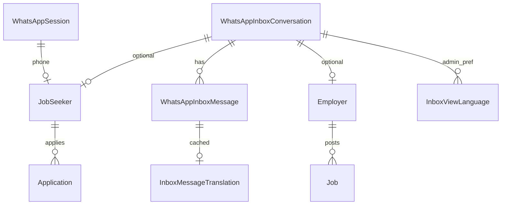

# AsliJobs WhatsApp Bot — Complete Technical Report

**Document type:** Code-based analysis (read-only)  
**Generated from repository:** `aslijobs/` (backend + admin + related frontend WhatsApp surfaces)  
**Scope:** Production WhatsApp Cloud API conversational bot, notification templates, inbound media normalization, Admin Inbox integration  
**Explicit non-goals:** No source changes, no live Meta/LLM/WhatsApp API calls, no production data inspection  

---

## 1. Report scope and methodology

### Methodology

1. Mapped backend routes under `/api/v1/whatsapp` and `/api/v1/operations/whatsapp-inbox`.
2. Traced the webhook receive path through persist → ACK → conversational enqueue → bot turn → send → inbox outbound record.
3. Inspected Sarvam chat, STT, and translate clients for exact model identifiers and prompts.
4. Inspected intent/local rules, session model, job/application reply builders, and notification template registry.
5. Separated **bot reply generation** from **Admin Inbox translation**.
6. Ran a safe local unit-test subset (no external APIs).

### Primary directories inspected

| Area | Path |
|------|------|
| Bot core | `backend/src/modules/whatsapp/` |
| Inbox store | `backend/src/modules/whatsapp/inbox/` |
| Notifications | `backend/src/modules/whatsapp/notifications/` |
| Admin inbox API | `backend/src/modules/operations/whatsapp-inbox/` |
| Admin UI | `admin/src/routes/operations-whatsapp-inbox-page.tsx`, `admin/src/components/operations/inbox/`, services/hooks/utils |
| App wiring | `backend/src/routes/index.ts`, `backend/src/app.ts`, `backend/src/server.ts`, `backend/src/config/env.ts` |

### Confidence legend

- **Confirmed:** Observed in source with path/function references.
- **Inferred:** Reasonable from code structure; not separately verified in production.
- **Not found:** Searched and not present in inspected code.
- **Unknown without ops access:** Requires logs, Meta dashboard, or env values.

---

## 2. Executive summary: How the bot currently works

### What the bot does (plain language)

AsliJobs runs a WhatsApp Business bot on Meta’s Cloud API. When someone messages the AsliJobs WhatsApp number, Meta posts a webhook to the AsliJobs backend. The backend:

1. Saves the message into the Admin WhatsApp Inbox.
2. Acknowledges Meta quickly (HTTP 200).
3. Optionally queues a conversational turn (BullMQ when Redis is configured; otherwise inline).
4. Looks up whether the phone belongs to a Job Seeker, Employer, both, or neither.
5. Understands the message mostly with **local rules**; only ambiguous longer messages call **Sarvam chat (`sarvam-105b`)** as an intent classifier.
6. Builds a **deterministic English reply template** (not free-form chat).
7. Translates that template into the user’s language with **Sarvam Mayura (`mayura:v1`)** when needed.
8. Sends a WhatsApp session text message and stores the bot reply in the Inbox.

Separately, lifecycle events (account created, interview scheduled, etc.) send **approved Meta template messages** through a notification queue—not through the conversational classifier.

### Who can interact

- Any WhatsApp user who messages the configured business phone number.
- Linked **Job Seekers** and **Employers** (matched by normalized phone).
- **Unregistered** users (guided toward website registration URLs).

### What users can accomplish on WhatsApp

**Confirmed in conversational bot:**

- Greetings / thanks / short acks (protocol templates).
- Numbered menus for new users / seekers / employers (limited conversation states).
- Public job search / count / details (with location/role clarification).
- Seeker profile skills, applications list/count/status (read-only style answers).
- Employer job list / status / application counts / post-job prompts / account status.
- “How to apply” guidance and website deep links (apply happens on the website).
- Voice notes → speech-to-text → same intent pipeline.

**Confirmed outside the chat classifier (templates):**

- OTP verification templates.
- Account created / profile completion / job post / application / interview notification templates (multi-language where registered).

**Not found as WhatsApp-native flows:**

- Full multi-step profile field collection entirely inside WhatsApp chat.
- Creating job applications inside WhatsApp without opening the website.
- Interactive interview scheduling dialogue inside the bot (scheduling is notification templates after other systems act).

### AI / external APIs used by the bot

| Provider | Model / API | Role |
|----------|-------------|------|
| Sarvam | `sarvam-105b` chat completions | Intent/language/location/category JSON classifier (fallback only) |
| Sarvam | `saaras:v3` then `saarika:v2.5` STT | Voice transcript |
| Sarvam | `mayura:v1` translate | Localize deterministic English replies; also Admin Inbox translations |
| Meta Graph | Cloud API messages + media | Send/receive WhatsApp |

**OpenAI / other LLMs for WhatsApp replies: Not found.**

### How replies are decided

1. Protocol detection (`Hi` / thanks / OK) → fixed reply, no LLM.
2. Menu digit in `conversationState` → fixed intent mapping.
3. Local `understandLocally` rules → if confident, skip LLM.
4. Else Sarvam classifier JSON → still mapped into deterministic situations.
5. `buildReply` chooses situation + facts (DB lookups for jobs/applications).
6. `buildDeterministicReply` produces English copy; Mayura translates to target language.

### How conversations are stored

- `WhatsAppSession` Mongo document per phone (language, pending search fields, last jobs, menu state; 14-day TTL on activity).
- Inbox: `WhatsAppInboxConversation` + `WhatsAppInboxMessage` for Admin UI and delivery statuses.
- Notification dispatches stored in notification models (separate from chat classifier).

### When services fail

- Webhook signature/verify failures → 403.
- Persist failure before ACK → 500 (Meta may retry).
- After ACK, bot failures are logged; `sendTextMessage` swallows errors so the worker does not crash.
- Voice STT failure → localized “unclear voice” reply.
- Translation failure → service-error copy (when generated language ≠ target).
- Missing Redis → inline processing (less durable across restarts).
- Empty `META_APP_SECRET` → signature verification effectively bypassed (**confirmed code risk**).

---

## 3. Current architecture diagram

```mermaid
flowchart TD
  U[WhatsApp User] -->|message| META[Meta WhatsApp Cloud API]
  META -->|POST /api/v1/whatsapp/webhook| WH[whatsapp-webhook.controller]
  META -->|GET verify| WV[verifyWhatsAppWebhook]
  WH -->|HMAC verify| SIG[whatsapp-signature]
  WH --> PERSIST[persistInboundMessages]
  PERSIST --> DESC[describeInboundWhatsAppMessage]
  PERSIST --> STORE[(WhatsAppInboxConversation / Message)]
  PERSIST --> STAT[persistDeliveryStatuses]
  STAT --> STORE
  STAT --> NDISP[(Notification dispatch status)]
  WH -->|HTTP 200 ACK| META
  WH --> ROUTE[routeConversationalMessages]
  ROUTE --> CLAIM[claimWhatsAppEvent]
  ROUTE --> PAUSE{Bot paused?}
  PAUSE -->|yes| STOP[Inbox only]
  PAUSE -->|no| Q[enqueueWhatsAppInbound]
  Q -->|REDIS_URL set| BQ[[BullMQ whatsapp-inbound]]
  Q -->|no Redis / queue fail| INLINE[Inline handleConversationalMessage]
  BQ --> BOT[processInboundTurn]
  INLINE --> BOT
  BOT --> SESS[(WhatsAppSession)]
  BOT --> ACC[lookupAccount JobSeeker/Employer]
  BOT -->|audio| STT[Sarvam STT]
  BOT --> RULES[Protocol / Menu / understandLocally]
  RULES -->|fallback| LLM[Sarvam sarvam-105b classifier]
  BOT --> REPLY[buildReply + DB job/application queries]
  REPLY --> DET[buildDeterministicReply English]
  DET --> TR[Sarvam mayura:v1 translate]
  TR --> SEND[WhatsAppService.sendTextMessage]
  SEND --> META
  SEND --> STORE

  EVT[App lifecycle events] --> NQ[[BullMQ whatsapp-notifications]]
  NQ --> TPL[sendTemplateMessage]
  TPL --> META
  TPL --> STORE

  ADMIN[Admin Inbox UI] --> API[/operations/whatsapp-inbox]
  API --> STORE
  API --> ITR[inbox-translation.helpers + mayura:v1]
  API --> MEDIA[downloadMedia via Graph]
```

### Diagram walkthrough

1. Meta delivers user messages and delivery statuses to one webhook.
2. Signature check uses raw body captured in Express JSON middleware for `/whatsapp/webhook`.
3. Every inbound message is described and stored for the Admin Inbox **before** conversational routing.
4. HTTP 200 is sent after successful persist; bot work continues asynchronously relative to Meta’s HTTP wait (queue or inline after ACK).
5. Conversational routing claims the Meta message ID, respects human handoff pause, and enqueues text/audio only.
6. Bot turns serialize per phone (`runInPhoneOrder`), resolve account + session, classify, build deterministic reply, translate, send.
7. Templates for lifecycle notifications use a separate queue and Graph template API.
8. Admin Inbox reads the same inbox collections and can translate view language on demand (separate pipeline).

---

## 4. Incoming WhatsApp message: exact execution flow

### Stage-by-stage

| # | Stage | File | Function | Sync/Async | Notes |
|---|-------|------|----------|------------|-------|
| 1 | Meta POST | Cloud API → AsliJobs | — | External | Payload includes `entry[].changes[].value.messages/statuses` |
| 2 | Verify (setup) | `whatsapp-webhook.controller.ts` L30–43 | `verifyWhatsAppWebhook` | Sync | `hub.mode=subscribe` + `WHATSAPP_VERIFY_TOKEN` → echo challenge |
| 3 | Route | `whatsapp.routes.ts` | GET/POST `/webhook` | — | Mounted at `/api/v1/whatsapp` |
| 4 | Signature | `whatsapp-signature.ts` L3–24 | `verifyWhatsAppSignature` | Sync | Empty `META_APP_SECRET` returns **true** |
| 5 | Raw body | `app.ts` (~JSON verify hook) | Express | Sync | Required for HMAC |
| 6 | Persist inbox | `whatsapp-webhook.controller.ts` L182+ | `persistInboundMessages` | Async | Phone-number-id filter; describe; `recordInboundUserMessage` |
| 7 | Statuses | same L77+ | `persistDeliveryStatuses` | Async | Inbox + notification dispatch + reminder sync |
| 8 | ACK | controller L57–62 | `res.sendStatus(200)` | After persist | **Before** conversational processing completes |
| 9 | Route bot | L230–280 | `routeConversationalMessages` | Async after ACK | Claim → pause check → enqueue |
| 10 | Dedup | `whatsapp-processed-event.model.ts` | `claimWhatsAppEvent` | Async | Unique Meta `messageId`, TTL ~7 days |
| 11 | Queue | `whatsapp-inbound.queue.ts` L54–78 | `enqueueWhatsAppInbound` | Async | BullMQ jobId=messageId, attempts=2; else inline |
| 12 | Worker | queue L80–98 / `server.ts` | `startWhatsAppInboundRuntime` | Background | Concurrency `WHATSAPP_INBOUND_CONCURRENCY` (default 4) |
| 13 | Phone order | `whatsapp-phone-order.ts` | `runInPhoneOrder` | Async | Serializes turns per national phone |
| 14 | Bot turn | `whatsapp-bot.service.ts` L195+ | `processInboundTurn` | Async | Rate limit, pause, account, STT, understand, reply |
| 15 | Send | `whatsapp.service.ts` L541–578 | `sendTextMessage` | Async | Swallows errors; records outbound as `senderType: "bot"` |

### Message types routed to the bot

From `extractText` / audio branch (`whatsapp-webhook.controller.ts` L255–301):

- **Routed:** `text`, `button`, `interactive` (button/list reply titles), `audio` (media id for STT).
- **Not bot-routed:** `image`, `video`, `document`, `sticker`, `location`, `contacts`, `reaction`, `unsupported` (still **persisted** to Inbox via `describeInboundWhatsAppMessage`).

### Phone normalization

- `nationalPhone` in `whatsapp-bot.logic.ts` (last 10 digits for typical IN numbers).
- Account link via `resolveWhatsAppLinkedAccount` used by `lookupAccount` (`whatsapp-bot.service.ts` L115–131), cached 60s.

### Duplicate handling

- Inbox: unique `providerMessageId` on messages (duplicate create → not re-created).
- Bot: `claimWhatsAppEvent` + BullMQ `jobId`.
- Confirmed: webhook can persist inbox once while skipping bot if claim fails on retry—**desired** for bot idempotency.

---

## 5. AI and LLM integration

### A. Sarvam Chat — intent classifier

| Field | Value |
|-------|-------|
| Provider | Sarvam |
| Model | **`sarvam-105b`** (`SARVAM_CHAT_MODEL`) |
| Endpoint | `https://api.sarvam.ai/v1/chat/completions` |
| File | `sarvam.client.ts` (`understandMessage`) |
| Timeout | 8_000 ms |
| Trigger | `shouldUseLlmFallback` true after local understand |
| Output | JSON fields: intent, language, location, category, openSearch, confidence |
| System prompt | `UNDERSTAND_SYSTEM` (L15–16): classifier only; “Do not answer, authorize, or invent jobs.” |
| Free-form user reply generation | **Not used** |

### B. Sarvam STT

| Field | Value |
|-------|-------|
| Models tried | **`saaras:v3`** then **`saarika:v2.5`** |
| Endpoint | `https://api.sarvam.ai/speech-to-text` |
| File | `sarvam.client.ts` `transcribeWhatsAppAudio` |
| Trigger | Inbound audio with `mediaId` |

### C. Sarvam Mayura translate

| Field | Value |
|-------|-------|
| Model | **`mayura:v1`** |
| Endpoint | `https://api.sarvam.ai/translate` |
| Mode | `formal` |
| Language codes | `en-IN`, `hi-IN`, `te-IN`, `ta-IN`, `kn-IN`, `ml-IN` |
| Bot entry | `localizeDeterministicReply` (`sarvam-translate.client.ts` L335+) |
| Inbox entry | `translateInboxText` / draft translate (same client; inbox layout pipeline `inbox-v3`) |

### Env names (values not disclosed)

`SARVAM_API_KEY`, WhatsApp/Meta vars listed in §15, `REDIS_URL`, `FRONTEND_URL`.

---

## 6. Complete multilingual chat flow

### Supported language codes (bot)

`en | hi | te | ta | kn | ml` (`BotLanguage` in `whatsapp-bot.logic.ts`).

### Detection vs translation vs templates (do not conflate)

| Concern | Mechanism |
|---------|-----------|
| Detection | `detectLanguage` — Indic scripts + roman keyword heuristics + English clarity; can inherit previous for short/ambiguous |
| Classification language field | Local rules or Sarvam JSON `language` |
| Response generation | Deterministic **English** (or sometimes language-aware template strings) via `buildDeterministicReply` |
| Localization | Mayura translate English → target |
| Notification templates | Separate Meta template names/languages (`te`, `hi`, … not `te-IN`) |

### Precedence (confirmed patterns)

1. Protocol / STT hint / current-message script signals via `detectLanguage`.
2. Session `WhatsAppSession.language` used as previous/context.
3. JobSeeker `whatsappLanguage`: **seeded only if empty** by `persistJobSeekerWhatsAppLanguage` — website preference is not overwritten by chat (`job-seeker-whatsapp-language.ts` L113–116).
4. Notification language resolution prefers seeker saved language, then session, else English (`resolveJobSeekerNotificationLanguage`).

### Romanized / mixed text

- Roman Kannada/Telugu/etc. keyword lists exist in `whatsapp-bot.logic.ts` (e.g. `beku`, `kelasa`).
- Mixed English+Indic handling for **Admin Inbox translation** was tightened separately (`isAlreadyTargetLanguage`); bot detection still uses script/roman heuristics.

### Short messages

- `detectProtocolTurn` handles greetings/thanks/acks without LLM.
- Ambiguous short texts under 12 chars generally **do not** call LLM (`shouldUseLlmFallback`).

---

## 7. Intent classification and conversation state

### Intent list (confirmed)

From `BOT_INTENTS` (`whatsapp-bot.logic.ts` L14–36):

`GREETING`, `JOB_SEARCH`, `JOB_DETAILS`, `JOB_COUNT`, `PROFILE_MATCH`, `PROFILE_JOBS`, `MY_SKILLS`, `MY_APPLICATIONS`, `APPLICATION_COUNT`, `APPLICATION_STATUS`, `APPLIED_COVERAGE`, `HOW_TO_APPLY`, `EMPLOYER_JOBS`, `EMPLOYER_JOB_STATUS`, `EMPLOYER_APPLICATION_COUNT`, `POST_JOB`, `ACCOUNT_STATUS`, `HELP`, `CLARIFY`, `UNRELATED`, `UNKNOWN`.

### Detection methods (combined)

| Method | When |
|--------|------|
| Protocol regex/templates | Hi / thanks / OK family |
| Menu selection | Digits while `conversationState` in `NEW_USER_INTENT` / `SEEKER_MENU` / `EMPLOYER_MENU` |
| Local rules | `understandLocally` + criteria extractors |
| Role/account awareness | `applyRoleHints`, `applyAccountAwareIntent`, `crossRole` |
| Sarvam classifier | Fallback only |

### Conversation “state machine”

**Not a full FSM.** Limited fields:

- `conversationState`: `"" | NEW_USER_INTENT | SEEKER_MENU | EMPLOYER_MENU`
- Pending search: `pendingLocation`, `pendingCategory`, `pendingOpenSearch`, `pendingIntent`
- Last search memory: `lastLocation`, `lastCategory`, experience/salary, `lastJobs[]`

Topic changes mid-flow: new understand pass; pending fields cleared/set based on whether location/role still missing (`processInboundTurn` session write ~L429+).

### Intent → handler sketch

| Intent / condition | Trigger | Detection | Handler | DB | Response | Next |
|---|---|---|---|---|---|---|
| Protocol greeting | Hi/hello… | `detectProtocolTurn` | protocol reply | session upsert | greeting template | may set menu state |
| Menu digit | `1`/`2`… | `detectMenuSelection` | mapped intent | session | via `buildReply` | clears/uses menu |
| JOB_SEARCH | “driver in Hyderabad” | local/LLM | `searchJobs` / list public jobs | Job queries | job cards + apply URLs | may wait location/role |
| JOB_DETAILS | “1st job” / details | ordinal + lastJobs | details situation | remembered jobs | detail card | — |
| MY_APPLICATIONS / STATUS / COUNT | seeker questions | local/LLM | seeker application services | Application | status/list copy | — |
| POST_JOB / EMPLOYER_* | employer questions | local/LLM | employer job lists / URLs | Employer jobs | templates | — |
| Unknown user job ask | unregistered | `unknownUserAction` | `new_user` situations | none / progress flags | register URLs | — |
| UNKNOWN low confidence | ambiguous long text | LLM fallback | clarify/help/out_of_scope | — | templates | — |

---

## 8. Job Seeker registration and profile management

### Confirmed behavior

- WhatsApp does **not** walk field-by-field registration in chat.
- Unregistered users get **website links** (`siteUrls`: `/job-seeker/register`, employer register, post-job, company profile) with language query where applicable.
- `lookupAccount` / `resolveWhatsAppLinkedAccount` only **finds** existing seeker/employer by phone; progress flags can mark incomplete profiles.
- `persistJobSeekerWhatsAppLanguage` may set `whatsappLanguage` once if empty.
- OTP registration uses template send path (`sendOtpMessage`), not the conversational classifier.

### Not found

- WhatsApp wizard collecting name/city/skills turn-by-turn with validation state machine.

---

## 9. Job search, applications, interviews

### Job search (bot)

- Public active jobs listing via services referenced in `buildReply` / `searchJobs` (trace labels `listPublicActiveJobs`).
- Clarifies missing city/role; supports open search; remembers `lastJobs` for ordinal follow-ups.
- Apply CTA: **public website URL** `buildPublicJobApplyUrl` → `{FRONTEND_URL}/jobs/{id}?lang=…`.

### Applications

- Bot can **read** seeker applications (list/count/status/coverage).
- **Creating** an application on WhatsApp itself: **Not found** (link-out).

### Interviews

- Conversational scheduling UI: **Not found**.
- Outbound Meta templates for scheduled/rescheduled/cancelled (phone/online/offline variants) via notification modules.

---

## 10. Outgoing WhatsApp messages and template system

### Session text (bot + admin)

- Bot: `WhatsAppService.sendTextMessage` — pause check, Graph send, inbox persist as `bot`, errors swallowed.
- Admin: `sendSessionTextMessage` — errors surfaced to API.

### Templates

- OTP: `WHATSAPP_OTP_TEMPLATE_NAME` + `WHATSAPP_TEMPLATE_LANGUAGE`.
- Lifecycle: `WHATSAPP_NOTIFICATION_TEMPLATES` in `whatsapp-notification.constants.ts`.
- Language codes for templates: Meta codes `en|te|hi|ta|kn|ml` (Kannada **name** suffix `_ka`, language `kn`).
- Resolver: `resolveWhatsAppTemplateForLanguage` in `whatsapp-notification.policy.ts`.
- Queue: `whatsapp-notifications` / job `send-template`.

### Status meanings (confirmed separation)

| Status | Meaning in this codebase |
|--------|---------------------------|
| accepted | Graph accepted / locally recorded after send API success path |
| sent / delivered / read | From Meta `statuses[]` webhook applied via rank-gated updates |
| failed | Status webhook or send failure paths with sanitized reason |

**Do not treat Graph send success alone as delivered/read.**

---

## 11. Queue, worker, Redis, background processing

| Queue | Purpose | Producer | Consumer |
|-------|---------|----------|----------|
| `whatsapp-inbound` | Conversational turns | `enqueueWhatsAppInbound` | Worker in `server.ts` process |
| `whatsapp-notifications` | Template sends | notification enqueue | Worker in same process |
| Reminder queues | Profile/job incomplete reminders | reminder modules | in-process |

**No dedicated npm script** like `whatsapp:worker` — workers start with API (`startWhatsAppInboundRuntime`, notification runtime).

**Without Redis:** inbound handled inline after ACK; notifications warned as non-durable in production env checks.

**Retries:** inbound attempts=2, exponential backoff 2s; failed jobs retained (removeOnFail: 100).

**Dedup:** BullMQ jobId = Meta messageId; processed-event claim.

---

## 12. Incoming media and non-text messages

| Type | Inbox persist | Bot understands content? | Notes |
|------|---------------|--------------------------|-------|
| text/button/interactive | Yes | Yes | Primary path |
| audio/voice | Yes + media id | Yes via STT | Only media type bot-routed |
| image/video/document | Yes + media id | **No** | Admin can download/preview |
| sticker | Yes as image media | **No** | Previewable in Inbox |
| location/contacts/reaction | Text description | **No** | |
| Meta `unsupported` | Descriptive placeholder | **No** | Cloud API did not deliver content |

**OCR / vision: Not found.**  
Displaying media in Admin Inbox ≠ bot comprehension.

---

## 13. Database and data flow

### Key models

| Model | Role |
|-------|------|
| `WhatsAppSession` | Per-phone conversational memory (14-day TTL) |
| `WhatsAppProcessedEvent` | Bot idempotency |
| `WhatsAppInboxConversation` | Thread metadata, preview, unread, bot pause, CS window |
| `WhatsAppInboxMessage` | Inbound/outbound bodies, media refs, delivery status |
| `InboxViewLanguage` | Admin per-user view language |
| `InboxMessageTranslation` | Cached inbox translations (`inbox-v3`) |
| Notification dispatch models | Template send tracking |
| `JobSeeker` / `Employer` | Account link + `whatsappLanguage` (seeker) |
| Jobs / Applications | Queried for deterministic replies |

### ER sketch



### Message lifecycle

Inbound Meta → describe → inbox message `delivered` → optional bot claim → understand → deterministic reply → translate → Graph send → outbound inbox `accepted` → later statuses update same `providerMessageId`.

---

## 14. Admin Dashboard WhatsApp Inbox integration

| Concern | Implementation |
|---------|----------------|
| UI | `admin` Operations WhatsApp Inbox page + chat/list components |
| API | `/api/v1/operations/whatsapp-inbox/*` |
| Bot messages | Appear as outbound `senderType: "bot"` |
| Human handoff | `POST .../bot` pause → `isBotPausedForPhone` blocks auto-replies |
| Translations | On-demand `POST .../translations` + draft translate; **does not** drive bot generation |
| Media | `GET .../messages/:id/media` → Graph download via stored `mediaProviderId` |
| View language | Per admin/conversation preference; independent of seeker notification language |

**Confirmed separation:** Inbox Mayura translation pipeline ≠ bot reply generation pipeline (shared translate client only).

---

## 15. Error handling, reliability, and security

| Issue | Handling | File | Risk |
|-------|----------|------|------|
| Bad verify token | 403 | webhook controller | Low |
| Bad signature | 403 if secret set | signature.ts | **Critical if secret empty (bypass)** |
| Persist fail | 500 before ACK | webhook controller | Meta retries |
| Duplicate webhook | claim + jobId | processed-event / queue | Confirmed |
| Bot paused | skip enqueue / skip send | inbox-store / sendTextMessage | Confirmed |
| Rate limit | max 20 replies / phone / 60s | `allowReply` | Confirmed |
| STT fail | unclear-voice reply | bot.service | Confirmed |
| LLM fail | local understanding source may remain / remote source flag | sarvam.client | Inferred fallback to local parse paths |
| Translate fail | service error copy | localizeDeterministicReply | Confirmed |
| Send fail | logged; null returned | sendTextMessage | User may see no reply |
| Redis down | inline handle / enqueue catch | inbound.queue | Durability reduced |
| Prompt injection | classifier prompt forbids answering; replies deterministic | sarvam.client / logic | Residual risk if classifier JSON abused—mitigated by not sending model prose |

---

## 16. Performance and cost-relevant behavior

### Typical LLM/STT/translate usage

| Scenario | Chat LLM | STT | Translate |
|----------|----------|-----|-----------|
| Simple “Hi” | 0 | 0 | 0–1 (if protocol reply already localized templates may skip) |
| Confident local job search | 0 | 0 | 1 (if language ≠ generated) |
| Ambiguous long text | 1 | 0 | 1 |
| Voice note | 0–1 | 1 | 1 |
| Image/PDF | 0 | 0 | 0 (no bot route) |

Also: LLM fallback path sends a short “looking at your question” ack in parallel with classifier (`processInboundTurn` ~L358–366) → extra Graph send.

### Cost growth risks (code-based)

- Long histories are **not** sent to the classifier (single-turn JSON classify)—good.
- Translation caching only for cacheable situations (`isCacheableSituation`).
- Repeated user messages can re-process if new Meta IDs (expected).

Exact ₹/$ costs: **Unknown** without Sarvam/Meta billing.

---

## 17. Automated tests and verification results

### Representative test files

- `whatsapp-bot.test.ts`, `whatsapp-bot.criteria.test.ts`, `whatsapp-bot.role.test.ts`
- `whatsapp-inbound-message.test.ts`, `whatsapp-media.test.ts`, `whatsapp-phone-order.test.ts`
- `whatsapp.service.test.ts`
- `inbox/whatsapp-inbox-store.test.ts`, template text/render tests
- Notification policy/lifecycle/service tests
- Admin: `inbox-message-display.test.ts`, composer/format/draft translation tests
- Inbox translation helpers tests under operations module

### Tests executed for this report (local, no external APIs)

```
whatsapp-inbound-message.test.ts
whatsapp-media.test.ts
whatsapp-phone-order.test.ts
inbox/whatsapp-inbox-store.test.ts
```

**Result: 30/30 passed** (observed in this session).

Full `npm test` suite and live Meta/Sarvam integration: **not run** here.

### Coverage gaps (confirmed by absence / partial focus)

- End-to-end live webhook → Graph send.
- Production Redis worker crash recovery.
- Full interview template send against Meta.
- OCR/vision (feature absent).

---

## 18. Current limitations and prioritized findings

### Critical

1. **Empty `META_APP_SECRET` disables signature verification** (`whatsapp-signature.ts` L8–11). Impact: forged webhooks possible if exposed. Confirmed code behavior; production config unknown.

### High

2. **Meta `unsupported` messages cannot deliver media** — Inbox shows informative fallback; content unrecoverable. Confirmed.
3. **Bot ignores image/document/video for understanding** — only persists. Confirmed.
4. **No durable inbound media blob store** — Meta media IDs expire; later Inbox download can fail. Confirmed architecture.
5. **Empty Redis reduces durability** of queues across restarts (env warning exists). Confirmed.

### Medium

6. Conversational registration is link-out only — incomplete profiles not completed via WhatsApp Q&A. Confirmed.
7. Applications not created in-chat. Confirmed.
8. LLM fallback “looking at…” ack can send an extra message before final answer. Confirmed.
9. Admin Inbox translation quality depends on Mayura + layout pipeline (separate from bot). Confirmed.

### Low

10. No dedicated WhatsApp worker process/script — ops must treat API process as worker host. Confirmed.
11. Frontend WhatsApp FAB/deep links are marketing/entry UX, not the bot runtime. Confirmed present under `frontend/`.

---

## 19. Complete source code reference map

| Component | File path | Main symbols | Responsibility | Calls into |
|-----------|-----------|--------------|----------------|------------|
| Route mount | `backend/src/routes/index.ts` | `apiRouter.use("/whatsapp")` | HTTP mount | whatsapp.routes |
| Webhook routes | `whatsapp/whatsapp.routes.ts` | GET/POST webhook | Bind controller | webhook.controller |
| Webhook controller | `whatsapp-webhook.controller.ts` | `verify*`, `receive*`, persist, route | Entry orchestration | signature, store, queue, describe |
| Signature | `whatsapp-signature.ts` | `verifyWhatsAppSignature` | HMAC | crypto |
| Inbound describe | `whatsapp-inbound-message.ts` | `describeInboundWhatsAppMessage`, `inboxListPreview` | Normalize types | — |
| Inbound queue | `whatsapp-inbound.queue.ts` | `enqueue*`, `start*Runtime` | BullMQ/inline | bot.service |
| Bot service | `whatsapp-bot.service.ts` | `handleConversationalMessage`, `processInboundTurn`, `buildReply` | Turn orchestration | logic, sarvam, translate, WhatsAppService, session |
| Bot logic | `whatsapp-bot.logic.ts` | intents, `understandLocally`, `detectLanguage`, `buildDeterministicReply` | Rules + templates | criteria |
| Criteria | `whatsapp-bot.criteria.ts` | place/salary/experience extractors | Parsing helpers | — |
| Session | `whatsapp-session.model.ts` | `WhatsAppSessionModel` | Memory | mongoose |
| Processed events | `whatsapp-processed-event.model.ts` | `claimWhatsAppEvent` | Idempotency | mongoose |
| Phone order | `whatsapp-phone-order.ts` | `runInPhoneOrder` | Per-phone mutex | — |
| Graph client | `whatsapp.service.ts` | send/upload/download | Meta API | fetch, inbox-store |
| Media rules | `whatsapp-media.ts` | validate/safe names | MIME/size | — |
| Sarvam chat/STT | `sarvam.client.ts` | `understandMessage`, `transcribeWhatsAppAudio` | AI classify/STT | logic.parseUnderstanding |
| Sarvam translate | `sarvam-translate.client.ts` | `translateText`, `localizeDeterministicReply` | Localization | logic.buildDeterministicReply |
| Language seed | `job-seeker-whatsapp-language.ts` | resolve/persist | Notification + seed | JobSeeker, session |
| Inbox models | `inbox/whatsapp-inbox.model.ts` | Conversation/Message | Persistence schema | — |
| Inbox store | `inbox/whatsapp-inbox-store.ts` | record inbound/outbound, pause, CS window | Inbox writes | models |
| Notifications | `notifications/*` | enqueue, templates, policy | Template messaging | WhatsAppService, queues |
| Admin inbox API | `operations/whatsapp-inbox/*` | list/send/translate/media | Ops UI backend | store, translate helpers, WhatsAppService |
| Inbox translate | `inbox-translation.helpers.ts` | `translateInboxText` | Structured translate | sarvam-translate |
| Admin UI | `admin/src/.../inbox/*` | ChatPanel, list, hooks | Ops UX | operations WhatsApp service |
| Server boot | `backend/src/server.ts` | start runtimes | Start workers | inbound + notification queues |

---

## 20. End-to-end execution traces

### A. Simple greeting “Hi”

1. Webhook verify signature → persist text inbox message.  
2. ACK 200.  
3. Claim event → enqueue.  
4. `detectProtocolTurn` → greeting template.  
5. Update session language/state; optional seeker language seed.  
6. `sendTextMessage` → Graph + inbox bot message.  
7. **No** Sarvam chat; translation may be embedded in protocol copy path / skipped per implementation details of `protocolReply`.

### B. Telugu job-search request

1. Persist Telugu text.  
2. Local and/or Sarvam understand → `JOB_SEARCH`, `language=te`, location/role.  
3. Possibly clarify missing slot.  
4. Else query public jobs → deterministic English job card facts.  
5. Mayura `en-IN`→`te-IN`.  
6. Send Telugu session text + apply links with `lang` query.

### C. Apply for a job

1. User asks how to apply / receives job card.  
2. Bot returns website apply URL.  
3. **Application document creation happens on website**, not in this webhook path.

### D. Mixed-language message

1. Detection heuristics / classifier language field.  
2. Reply localized to resolved target language via Mayura.  
3. Exact quality depends on detection + Mayura (ops unknown).

### E. Unknown intent

1. Local UNKNOWN + maybe LLM.  
2. `clarify` / `help` / `out_of_scope` / `new_user` situations.  
3. Deterministic copy + translate.

### F. API / translation failure

1. Translate fail → `serviceErrorCopy` when needed.  
2. Send fail → logged, null; user may get no final message.  
3. STT fail → unclear voice message.

---

## 21. Final conclusions

The active AsliJobs WhatsApp system is a **Meta Cloud API + Sarvam-assisted, template-first bot**:

- Webhook persists everything to the Admin Inbox first, ACKs Meta, then optionally runs conversational logic.
- Sarvam chat is a **classifier**, not a conversational author.
- User-visible replies are **deterministic templates** localized by Mayura.
- Lifecycle messaging is a **separate template notification pipeline**.
- Admin Inbox translation is a **third pipeline** sharing Mayura but not controlling bot decisions.

---

## A. How the bot works today (10–15 steps)

1. User messages AsliJobs on WhatsApp.  
2. Meta POSTs webhook to `/api/v1/whatsapp/webhook`.  
3. Signature verified (if secret configured).  
4. Message normalized and saved to Inbox.  
5. Delivery statuses applied when present.  
6. HTTP 200 returned to Meta.  
7. Event claimed for bot idempotency; skipped if bot paused.  
8. Text/interactive/button/audio enqueued (BullMQ or inline).  
9. Per-phone ordered turn loads session + JobSeeker/Employer link.  
10. Audio transcribed via Sarvam STT when needed.  
11. Intent resolved by protocol/menu/local rules, else Sarvam classifier.  
12. `buildReply` gathers jobs/applications/facts.  
13. English deterministic reply built, then Mayura-translated.  
14. Session text sent via Graph; bot message stored in Inbox.  
15. Later Meta status webhooks update delivered/read/failed.

## B. Current AI and external services

| Service | Identifier | Purpose | Trigger |
|---------|------------|---------|---------|
| Sarvam Chat | `sarvam-105b` | Intent/language JSON | Ambiguous long messages |
| Sarvam STT | `saaras:v3`, `saarika:v2.5` | Voice → text | Inbound audio |
| Sarvam Translate | `mayura:v1` | Localize replies; Inbox translations | Non-English replies / inbox translate API |
| Meta Graph | Cloud API | Send/receive WhatsApp + media | All WA I/O |

## C. Confirmed issues and missing features

- Signature bypass when `META_APP_SECRET` empty.  
- Bot does not understand image/PDF/video content.  
- Meta unsupported payloads have no recoverable media.  
- No durable media object storage.  
- No in-chat full registration wizard or in-chat application create.  
- Workers colocated with API process; Redis optional.

## D. Questions the code cannot answer

- Whether production secrets/tokens/Redis are correctly set.  
- Live Meta WABA quality rating, template approval drift, phone number health.  
- Actual Sarvam/Meta monthly spend and latency SLOs.  
- Real distribution of `unsupported` subtypes in production logs.  
- Whether all localized `_te/_hi/_ta/_ka/_ml` templates remain APPROVED in Meta today.  
- End-user demographics and success rates of job-search clarifications.

---

*End of report.*
